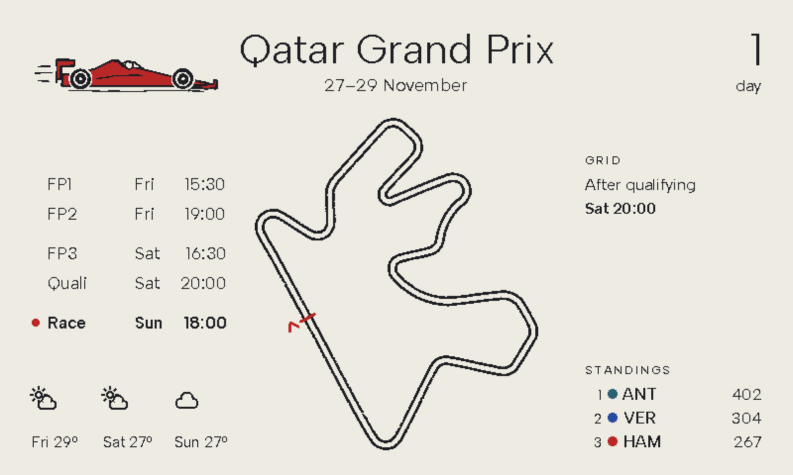

# F1 e-ink card

A countertop e-paper frame (7.3" E Ink Spectra 6, 800×480) that shows the next Formula 1 race:
race name and dates, days to go, the circuit, the weekend schedule in Vilnius time, the weekend
forecast, the top 5 of qualifying and the top 3 of the championship.

## How it works

GitHub Actions runs every 30 minutes. It pulls fresh data, draws the card and publishes it to the
`display` branch, which only ever holds the latest card. The frame wakes up, downloads the card and
redraws only if it changed (ETag).

| File on the `display` branch | What it is |
|---|---|
| [`f1.epdgz`](https://raw.githubusercontent.com/manijjaa/F1-display/display/f1.epdgz) | what the frame downloads: exact panel pixels, no dithering on the device |
| [`f1_preview.png`](https://raw.githubusercontent.com/manijjaa/F1-display/display/f1_preview.png) | 2× preview in "real panel" colours |
| [`f1.png`](https://raw.githubusercontent.com/manijjaa/F1-display/display/f1.png) | the same card as a plain PNG |
| [`status.json`](https://raw.githubusercontent.com/manijjaa/F1-display/display/status.json) | what was drawn, when, and whether any API was down |

## Frame setup

Flash [esp32-photoframe](https://github.com/aitjcize/esp32-photoframe) (Waveshare PhotoPainter or
Seeed XIAO EE04), set orientation to landscape, rotation mode to URL, and the image URL to
`https://raw.githubusercontent.com/manijjaa/F1-display/display/f1.epdgz`.

## Rules

- The card moves to the next race at 06:00 Vilnius on the Monday after a race.
- Grid: top 5 in qualifying order once results are out; before that, when qualifying starts.
- Weather: shown once the whole weekend is inside the 16-day forecast (circuit local days).
- Standings: current season top 3; before round 1, last season's final table.
- If an API is down, the last good data is used (`status.json` lists it under `stale`).

## Files

| | |
|---|---|
| `make_image.py` | entry point: fetch, render, write the output files |
| `f1data.py` | data layer: Jolpica-F1 (schedule, qualifying, standings), Open-Meteo (weather) |
| `render.py`, `track.py`, `icons.py`, `car_sketch.py` | the locked card design |
| `overrides.yaml` | manual fixes: rename a race, correct session times, add a race the API lacks |
| `circuits.yaml` | per-circuit map tweaks: rotation, start/finish point, direction |
| `tests/` | offline tests with sample API responses |

Run locally: `pip install -r requirements.txt`, then `python make_image.py` (writes `site/`) or
`python tests/test_offline.py`.

## Credits

- Data: [Jolpica-F1](https://github.com/jolpica/jolpica-f1), weather by [Open-Meteo](https://open-meteo.com/) (CC BY 4.0)
- Circuit outlines: [bacinger/f1-circuits](https://github.com/bacinger/f1-circuits) (MIT, see `assets/circuits/LICENSE.md`)
- Font: [Albert Sans](https://fonts.google.com/specimen/Albert+Sans) (SIL OFL, see `assets/fonts/OFL.txt`)
- Not affiliated with Formula 1. F1 and Formula 1 are trademarks of Formula One Licensing B.V.
